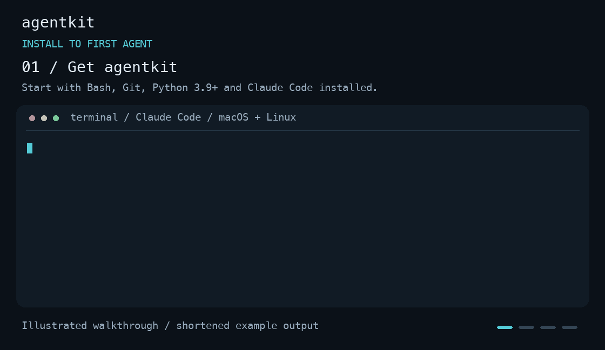

# Install

| Tool | Need | Used for |
|---|---|---|
| macOS, Linux, or native Windows | required | The platform. WSL2 is a separate Linux environment. |
| Bash 3.2 or newer | POSIX only | The shell installer and optional POSIX integrations. |
| PowerShell | native Windows bootstrap | Run `install.ps1`. Windows CI uses PowerShell 7. |
| `curl` | POSIX bootstrap command only | Download the shell installer. |
| `git` | required | Clone and update. |
| Python 3.9 or newer | required | The shared CLI. On POSIX, the command is `python3`. On Windows, the launcher checks `python`, `python3`, then `py -3`. |
| `claude` or `codex` | required for each selected target | The agent CLI you install for. A desktop app does not replace it. |
| `gh` | optional | `agentkit feedback`. |
| `bun` | required for gstack | Install and run gstack. Not required when you decline or skip gstack, or on native Windows. |

On macOS and Linux, when a tool is missing, install does this:

1. It prints a list of all tools. `✓` means found. `✗` means missing or too old.
2. It suggests an install command for each missing tool.
3. It asks `y/N` before it runs a command.

These dependency-install rules apply to macOS and Linux. For required tools, native Windows reports missing requirements and asks you to install them yourself. Optional desktop installation has a separate confirmation. It can run an official installer or Microsoft Store installation through `winget`.

Rules:

- With `--yes`, install accepts commands from a package manager (for example `brew install git`).
- With `--yes`, install never runs a remote script (`curl ... | bash`). You must answer the prompt yourself, in a terminal.
- With no terminal and without `--yes`, nothing is installed. Install prints the commands.
- The check follows `--target`. With `--target claude`, it needs `claude`. With `--target codex`, it needs `codex`. With `--target both`, it needs both CLIs.
- Without `--target`, install selects targets from the desktop apps and CLIs it detects. Each selected target still requires its CLI.
- A detected desktop app and its CLI have separate status lines. A missing CLI remains a required dependency, even when the desktop app is installed.
- With `--dry-run`, install only reports. It runs nothing.

### Platform status

The requirements check detects package managers, not distribution names.

| Environment | Dependency package manager | Verification coverage |
|---|---|---|
| macOS | Homebrew, if present | Existing CI job. |
| Debian / Ubuntu | `apt-get` | Existing Ubuntu CI job. |
| Fedora | `dnf` | Fedora 43 container CI passed at `9cb96b4`. |
| Arch Linux | `pacman` | Arch base container CI passed at `9cb96b4`. |
| openSUSE | `zypper` | Tumbleweed container CI passed at `9cb96b4`. |
| Alpine Linux | `apk` | Alpine 3.22 container CI passed at `9cb96b4`. See prerequisites below. |
| Native Windows | Manual prerequisite installation | Python 3.9/3.13 lifecycle and PowerShell bootstrap tests passed at `9cb96b4`. |
| Windows with WSL2 | The Linux distribution's manager | Manual verification required. |
| Other Linux distributions | Manual prerequisite installation | No distribution-specific CI. |

The [shared-core CI run at `9cb96b4`](https://github.com/IbrahimHosseini/agentkit/actions/runs/42972579681) passed all 12 jobs. It covered the existing Ubuntu and macOS shell checks, Fedora 43, Arch base, openSUSE Tumbleweed, and Alpine 3.22 containers, and Python 3.9 and 3.13 on Linux, macOS, and native Windows.

Each Windows Python suite reported 48 tests: 38 passed and ten skipped for platform or privilege limits. Each Windows PowerShell suite reported 12 passed, zero failed, and 12 total.

Tests use fake target CLIs and local Git repositories. They do not verify real Claude Code, Codex, Bun, or gstack execution. WSL2 has not been tested on a Windows machine.

On Linux, if no supported package manager is found, install Bash, `curl`, `git`, Python 3.9 or newer, and your target CLI yourself. Then use the same Bash installer below. A missing optional tool does not prevent the core install. Non-root dependency installation requires `sudo`; on systems without it, install prerequisites as root first.

### macOS and Linux

Run this command in a terminal on **macOS or Linux**:

```bash
curl -fsSL https://raw.githubusercontent.com/IbrahimHosseini/agentkit/main/install.sh | bash
```

The script clones the repo to `~/.agentkit`, then runs `agentkit install`. After that installation succeeds, it links the CLI to `~/.local/bin/agentkit`. Each change to your settings asks for a yes first.

The installer checks desktop apps separately from CLIs. On macOS, it checks system and user Applications folders. On Windows, it checks supported installation records and application locations. On Linux, existing Claude Desktop detection is informational; installation requires Claude Code CLI. It recognizes Claude, the older Codex app, and the new ChatGPT app that contains Codex. ChatGPT Classic does not count as Codex.

Desktop installation is optional. It needs a separate interactive confirmation, even with `--yes`. The installer uses official downloads for supported systems and architectures. When automatic installation is unavailable, complete the official installer, then let agentkit check the result. Opening an installer does not mean installation succeeded.

On macOS, automatic installation checks the downloaded app signature and installs into `~/Applications`. Existing apps are not replaced. On Linux, agentkit never offers or installs Claude Desktop and always requires Claude Code CLI. Other desktop support depends on the distribution and version; the installer explains unsupported combinations. See the official [Claude download page](https://claude.com/download) and [ChatGPT with Codex download page](https://chatgpt.com/download/) for current availability.

If you accept gstack installation, agentkit installs and checks Bun before gstack setup. A failed Bun installation stops that installation. Use `--skip gstack` if you do not want gstack or Bun.

### Alpine prerequisites

The bootstrap needs Bash before it can check dependencies. In an Alpine root shell, install the bootstrap tools first:

```sh
apk add --no-cache bash curl git python3
```

Then install a compatible target CLI and run the Bash install command above. [Alpine uses musl](https://www.alpinelinux.org/about/). A working agentkit shell/Python install does not establish compatibility for Claude Code, Codex, Bun, or gstack. Check each upstream tool's requirements. To check the core install without optional gstack or the Claude plugin, use:

```bash
curl -fsSL https://raw.githubusercontent.com/IbrahimHosseini/agentkit/main/install.sh | bash -s -- --skip gstack --skip karpathy
```

### Native Windows

Native Windows support is merged into `main`. Clone the repository, then run its PowerShell bootstrap.

Install Python 3.9 or newer, Git for Windows, and the native CLI for each selected target first. Add these tools to PATH and open a new terminal. The bootstrap prints guidance for missing prerequisites. It does not install these tools. If a target CLI is missing, the core provides official instructions and can check again after manual installation.

Run in PowerShell:

```powershell
git clone https://github.com/IbrahimHosseini/agentkit.git
Set-Location agentkit
$env:AGENTKIT_HOME = (Get-Location).Path
& .\install.ps1 --target codex
& "$env:USERPROFILE\.local\bin\agentkit.cmd" doctor --target codex
```

Use `--target claude` or `--target both` when needed. Use `--dry-run` to inspect changes, or `--yes` to accept prompts. The script uses the checkout named by `AGENTKIT_HOME`. Without that variable, it uses `%USERPROFILE%\.agentkit` and clones there if the directory does not exist. Use `AGENTKIT_HOME` when you want to install from a specific checkout.

The bootstrap writes an ordinary launcher to `%USERPROFILE%\.local\bin\agentkit.cmd`. It backs up an existing launcher before replacement. It does not need administrator access, WSL, Bash, or permission to create symlinks. It does not change PATH, the registry, or execution policy. Add the launcher directory to your user PATH yourself if you want to type `agentkit`. If local policy blocks PowerShell scripts, use your organization's approved process. The core can also run directly:

```powershell
python -I .\lib\agentkit.py install --target codex
python -I .\lib\agentkit.py doctor --target codex
```

Native Windows runs `install`, `update`, `models`, `doctor`, `uninstall`, `version`, and `help` through the same Python engine as macOS and Linux. Default target folders are `%USERPROFILE%\.claude` and `%USERPROFILE%\.codex`. `CLAUDE_CONFIG_DIR` and `CODEX_HOME` override them. Keep Windows and WSL configurations separate.

The first native version does not install gstack, the Karpathy plugin, Bash hooks, or auto-update hooks. It prints this limit. `auto-update`, `log`, and `feedback` remain POSIX commands. Codex agents can still include the bundled Karpathy instruction text. A `.cmd` or `.bat` target command cannot use shell metacharacters in its executable path or arguments: `& | < > ^ % !`, embedded double quotes, carriage returns, or newlines. This restriction does not apply to native `.exe` arguments. Use a native executable or a path without these characters.

### Upgrade an existing installation

Existing target manifests and backup folders keep the same layout. No manual configuration conversion is needed. After you update the agentkit checkout, run `agentkit update`. The shared engine reads the existing `agentkit/manifest.json`, keeps user-edited files, and writes a `.agentkit-new` file when an upstream change needs review. Files outside managed blocks stay in place. Keep your existing `CODEX_HOME` or `CLAUDE_CONFIG_DIR` overrides during the upgrade.

### Windows through WSL2

Use a Linux environment in WSL2. Follow the [Microsoft WSL installation guide](https://learn.microsoft.com/en-us/windows/wsl/install). In an administrator PowerShell window:

```powershell
wsl --install
```

Restart if requested, then finish the Linux user's setup. Check that the distribution uses version 2 with `wsl --list --verbose` in PowerShell. The default installation uses Ubuntu and WSL2. See [Microsoft's command reference](https://learn.microsoft.com/en-us/windows/wsl/basic-commands) for existing installations and other distributions.

Inside the Linux shell, install the Linux version of your target CLI and run the agentkit install command above. Run both tools from that same Linux environment. Use the Linux home directory for `~/.claude` and `~/.codex`. Do not point `CLAUDE_CONFIG_DIR` or `CODEX_HOME` at your native Windows configuration. This installation does not configure a native Windows CLI or desktop app.

The [manual WSL2 checklist](../CONTRIBUTING.md#manual-wsl2-verification) checks agentkit in a temporary home. A successful package-manager simulation is not a successful WSL2 test.

### What you see

Install prints a logo, then numbered steps such as `[2/6]`. Downloads show progress when available. Other long operations show a waiting indicator. Plain output shows the operation and its result. The final summary identifies completed, skipped, and failed items. `NO_COLOR` disables terminal styling. `--quiet` prints only errors and required questions.

An error identifies the failed stage and its known cause. It includes relevant output or a log path, plus a suggested next action. When the cause is unknown, the message includes the available failure details. A failed required step or accepted installation returns a nonzero exit code. Install does not report complete success after that failure. Errors remain visible with `--quiet`.

Pass flags after `bash -s --`:

```bash
curl -fsSL https://raw.githubusercontent.com/IbrahimHosseini/agentkit/main/install.sh | bash -s -- --dry-run
```

| Flag | Effect |
|---|---|
| `--dry-run` | Show what would change. Write nothing. |
| `--yes`, `-y` | Accept ordinary install prompts and use saved or default agent and model selections. `--skip-agent` overrides the saved agent exclusions. Remote scripts and desktop installation still need separate interactive confirmation. |
| `--target claude\|codex\|both` | Choose the CLI to install for. See below. |
| `--project DIR` | Install into `DIR/.claude` and `DIR/CLAUDE.md`, not into `~/.claude`. Claude only. |
| `--skip STEP` | Skip a step. STEP is `gstack`, `karpathy`, `claude-md`, `hooks` or `skills`. Repeat the flag to skip more. |
| `--skip-agent NAME` | Exclude an agent during `install`. Repeat the flag to provide the full list of exclusions for the selected targets. Required agents and dependencies of selected agents cannot be excluded. |
| `--force` | Replace files that already exist and that agentkit did not install. A backup is made first. |
| `--quiet` | Print only errors. Questions still show. |

### Targets

`--target` sets which CLI gets the install.

- Without `--target`, interactive installation opens a Providers checklist with detected providers already selected. Choose Claude, Codex, or both. Each selected provider requires its CLI. Installations with `--yes` or without a terminal use the detected providers.
- `update`, `uninstall` and `doctor` use every target that is already installed. Interactive `models` asks which installed target to configure first.
- With `--target claude`, files go to `~/.claude` (or `CLAUDE_CONFIG_DIR`).
- With `--target codex`, files go to `~/.codex` (or `CODEX_HOME`).
- `--target both` does both.
- `--project` works only for Claude. `--project` with `--target codex` or `both` is an error.
- `auto-update` is for Claude on POSIX only.

### Choose which agents to install

In the Providers and Agents checklists, use Up and Down to move, Space to toggle, Enter to confirm, and Esc to cancel. The Agents checklist shows standalone agents and one row per family. Space on a family toggles its specialists together. A fresh install starts with every role selected. Set `NO_COLOR=1` to turn off terminal colors.

`supervisor-plan` and `supervisor-review` are required for every installation. Selecting any role in the following table also selects and locks its dependencies. A locked parent stays selected when you toggle its specialists.

| Selected agent | Required agents |
|---|---|
| `frontend` | `design`, `tester` |
| `backend` | `database`, `security`, `tester` |
| `mobile` | `design`, `tester` |
| `devops` | `security` |

For example, to omit `frontend`, `mobile`, and their shared `design` dependency in a scripted Codex install, use:

```bash
agentkit install --target codex --yes --skip-agent frontend --skip-agent mobile --skip-agent design
```

Install saves exclusions separately for each target and for each Claude project install. Without `--skip-agent`, unattended runs use the saved exclusions, or select all agents on a fresh install. `agentkit install --dry-run` previews the selection without saving it. To change the selection or bring a skipped role back, rerun `agentkit install` interactively. When you exclude a previously installed role, agentkit backs up and removes its unmodified managed file after confirmation. In an unattended reinstall that removes files, pass `--yes` to confirm. Edited and user-owned files are kept.


### What install changes

The hooks, gstack, and Karpathy plugin rows below apply to POSIX systems only. Native Windows installs the agents, bundled skills, workflow blocks, and Codex configuration.

| Item | Where | Step name |
|---|---|---|
| Selected agent files (up to 50) | `~/.claude/agents/` | Claude target |
| Skills `agent-report`, `security-audit`, `write-swift` | `~/.claude/skills/` | `skills` |
| Workflow block between `<!-- agentkit:start -->` and `<!-- agentkit:end -->` | `~/.claude/CLAUDE.md` | `claude-md` |
| SubagentStop hook (agent log) | `~/.claude/settings.json` | `hooks` |
| SessionStart hook (auto-update, enabled by default for user installations) | `~/.claude/settings.json` | `hooks` |
| gstack (git clone, then its `./setup --host claude`) | `~/.claude/skills/gstack` | `gstack` |
| karpathy-guidelines plugin | through `claude plugin install` | `karpathy` |
| Selected Codex agents (up to 50 `.toml` files) | `~/.codex/agents/` | Codex target |
| `[agents.<name>]` blocks between `# agentkit:start` and `# agentkit:end` | `~/.codex/config.toml` | (always, target codex) |
| Workflow block between `<!-- agentkit:start -->` and `<!-- agentkit:end -->` | `~/.codex/AGENTS.md` | `claude-md` |
| Skills `agent-report`, `security-audit`, `write-swift` | `~/.codex/skills/` | `skills` |
| gstack (`./setup --host codex`) | The setup writes `~/.codex/skills/gstack-*`. With a codex-only install, the clone is `~/gstack`. | `gstack` |

Safety rules:

- agentkit never overwrites a file that you own. It skips the file and says so. Use `--force` to replace it.
- A symlinked skill folder or agent file is never adopted and never written through. agentkit skips it. `--force` replaces only the link, after a backup.
- If `~/.local/bin/agentkit` already exists and is not the agentkit link, `install.sh` asks before it replaces it.
- If an unmarked hook in `settings.json` looks like the agentkit hook, install converts it. The prompt shows the old and the new entry.
- If CLAUDE.md already has a `# Multi-agent workflow` section outside the markers, install warns you. The block would duplicate it.
- Before agentkit changes or removes a file, it copies the file to `~/.claude/agentkit/backups/<timestamp>/`.
- agentkit only edits the block between its two markers in CLAUDE.md. The rest of the file stays as it is.
- agentkit keeps a manifest with file hashes in `~/.claude/agentkit/manifest.json`.

Run `agentkit doctor` after the install.

### Codex

With target codex, agentkit converts each `agents/<name>.md` to a Codex custom agent.

- It writes `~/.codex/agents/<name>.toml`.
- It adds an `[agents.<name>]` block to `~/.codex/config.toml`. All blocks sit between `# agentkit:start` and `# agentkit:end`. The rest of the file stays as it is.
- It maps the Claude `model:` to a Codex model and effort with `codex/models.map`:

| Claude model | Codex model | Effort |
|---|---|---|
| `opus` | `gpt-6.1-sol` | `high` |
| `sonnet` | `gpt-6-luna` | `medium` |

- An `effort:` line in the agent file overrides the effort. To change a model, edit `codex/models.map`.
- The converter gives roles with `Edit` or `Write` a `workspace-write` sandbox and other roles a `read-only` sandbox. The security family always uses `read-only`.
- Agents that list `karpathy-guidelines` get the text of `codex/karpathy-guidelines.md` at the end of their instructions. It is the Codex equivalent of the plugin.
- The workflow block goes to `~/.codex/AGENTS.md`. It tells the main session to start workers as Codex subagents.
- The three skills are copied to `~/.codex/skills`.
- gstack uses `./setup --host codex`. This is experimental. Where the clone lives:
  - If `~/.claude/skills/gstack` has a clone, agentkit reuses it.
  - With target claude, the clone is `~/.claude/skills/gstack`. One install runs the setup for each host that needs it.
  - With a codex-only install, agentkit reuses `~/gstack` if it has a clone. If not, it clones gstack to `~/gstack`.
  - agentkit never clones gstack under `~/.codex/skills`. Doctor treats gstack as installed on Codex when `~/.codex/skills/gstack-*` exists.
   The safety skills (`careful`, `guard`, `freeze`) are advice only on Codex.
- If `~/.codex/agents/<name>.toml` exists and agentkit did not install it, agentkit skips it. It also leaves that agent out of `config.toml`. Use `--force` to replace it, after a backup.

Limits on Codex:

- There is no SubagentStop hook on Codex, so nothing is logged automatically. The `supervisor-review` agent file still tells the reviewer to run `agentkit log add` for each FIX. Codex may or may not follow this. Rules such as `scope` or `git-write` are never checked on Codex.
- There is no auto-update hook.
- Agent bodies describe capabilities using the host's native mechanisms. Claude frontmatter lists the tools for each role. Scoped delegation also requires the host to enforce the role's tool and file limits.
- `doctor`, `update` and `uninstall` cover both targets.

### Alternative: plugin install

Inside Claude Code:

```bash
/plugin marketplace add IbrahimHosseini/agentkit
/plugin install agentkit@agentkit
```

Plugin mode adds the full set of agents, the skills and the agent-log hook. Agent selection is available through `agentkit install`. Plugin agent names may get the prefix `agentkit:`. The agent log handles this. The workflow block and `agentkit` CLI are available through the standalone installer.

Do not use both modes at once. You would get two copies of the hook.

## Quick demo



The [`--agent` flag](https://code.claude.com/docs/en/cli-reference#cli-flags) selects the installed agent for the Claude Code session.

The example output in this GIF is illustrative. It shows a historical agent count. It is not a recording of a live agent session. The example uses Claude Code on macOS or Linux. It skips optional gstack and Karpathy installs. To rebuild the GIF, run `python3 -I scripts/render-demo.py` in an authoring environment with Pillow and a monospace font. Pillow is not needed to install or use agentkit.

## Guides

- [Choose models and effort](models.md)
- [Workflow and agent catalog](workflow.md)
- [Updates, health checks, uninstall, and troubleshooting](maintenance.md)
