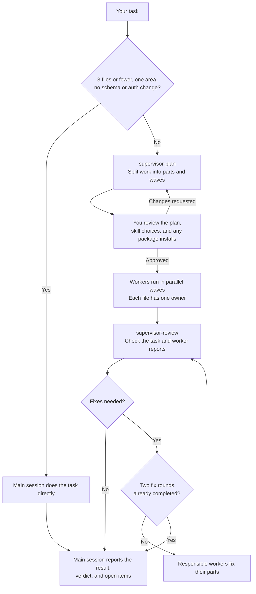

# Workflow and agents

## Usage

The workflow block in CLAUDE.md or AGENTS.md tells the main session how to work on tasks that change code or have several steps.



1. The `supervisor-plan` agent runs. It splits the task into parts and waves.
2. The main session shows you the plan: the number of agents, the waves, and the work of each agent. You approve it or change it. If a part needs an install, you approve the packages.
3. Workers run. Parts in the same wave run in parallel. Two parts never edit the same file.
4. The `supervisor-review` agent runs. It checks the worker reports against the task.
5. Each fix goes back to the worker that owns the part. A specialist's fix goes through its original parent to the same child role. `supervisor-review` runs again. The loop stops after 2 rounds.
6. You get the result, the verdict, and anything that is still open.

`supervisor-plan` is skipped for small tasks: 3 files or fewer, one area, no schema or auth change.

Example prompt:

```text
Add a "last login" column to the users table and show it on the admin page.
```

`supervisor-plan` can split this into a database part (migration), a backend part (API field), a frontend part (column) and a tester part. The plan shows you this split before any worker starts.

## Specialist families

After the main session approves a parent's assignment, the parent can handle the work itself or choose eligible specialists from the active target's roster supplied by the main session or installed workflow. Only the six parents below can delegate, and each can delegate only to its own children. [Family catalog](../agents/routing.json).

| Parent | Optional specialists |
|---|---|
| `design` | `design-ux-research`, `design-ux-architecture` |
| `seo` | `seo-aeo-foundations`, `seo-agentic-search`, `seo-ai-citations` |
| `marketing` | `marketing-aso`, `marketing-dev-community`, `marketing-email`, `marketing-instagram`, `marketing-linkedin`, `marketing-publishing`, `marketing-reddit`, `marketing-tiktok`, `marketing-x-engagement`, `marketing-x-research` |
| `product` | `product-trends`, `product-behavior`, `product-experiments` |
| `security` | `security-ai-code`, `security-architecture`, `security-compliance`, `security-appsec`, `security-credentials`, `security-threat-intel`, `security-detection` |
| `tester` | `test-accessibility`, `test-api`, `test-performance`, `test-e2e` |

The interactive installer toggles specialists as a family. A family with saved individual exclusions appears partially selected. Use `--skip-agent` to exclude a specific specialist in a scripted install. When another role brings in the parent as a dependency, specialist choices stay as selected. The required roles and automatic install dependencies are listed in [selection.json](../agents/selection.json).

A child assignment names both roles, the objective, permitted files and tools, inherited permissions, and acceptance checks. Each permission must be allowed by the parent assignment and the child role. A parent or specialist can also take a self-contained direct assignment with an explicit objective, permitted files and tools, and acceptance checks. Specialists complete assignments themselves. Design requires the user's approved option, security stays defensive, static, and read-only, and test children edit only assigned test files and use local fakes. X research stays read-only. Sending or publishing requires explicit consent for the destination channel and account, content, and action.

Native delegation requires the actual registered child with its model and effort, plus enforceable sandbox, tool, and file limits. Otherwise the parent returns the exact assignment to the main session, which launches that child if it can enforce the same limits and sends the evidence back to the parent. If a child is unavailable, the parent works within its own approved scope or reports the gap. The parent aggregates the evidence for `supervisor-review`.

For a fake payment webhook and checkout, `tester` can assign webhook contract checks to `test-api` and checkout flow checks to `test-e2e`. The children edit separate test files and use a fake provider. `tester` combines the actual check results for `supervisor-review`. Any follow-up fix goes through `tester` to the child that owned the check.

## Agents

| Agent | What it does | Model | Skills it uses |
|---|---|---|---|
| `architect` | Read-only architecture decisions, trade-offs, migration plans | opus | (none listed) |
| `backend` | Server code, APIs, business logic (Go, Python, Node/TypeScript) | sonnet | karpathy-guidelines |
| `database` | Schema, migrations, queries, indexes | sonnet | karpathy-guidelines, careful |
| `debugger` | Finds the root cause of a bug and makes a minimal fix | opus | karpathy-guidelines |
| `design` | UI/UX design, design systems, visual review | opus | karpathy-guidelines, animate, animate-expo, apple-design, emil-design-eng |
| `devops` | CI/CD, deployment files, Docker | sonnet | karpathy-guidelines, careful |
| `docs` | Developer docs, tested API references and quickstarts | sonnet | karpathy-guidelines, asd-ste100 |
| `frontend` | Web UI in React, Next.js, Vue/Nuxt, HTML, CSS | sonnet | karpathy-guidelines, browse |
| `marketing` | Strategy, positioning, campaigns, launch plans | sonnet | (none listed) |
| `mobile` | Swift/SwiftUI, Kotlin/Compose, Flutter/Dart apps | opus | karpathy-guidelines, write-swift |
| `payments` | Checkout, billing, and reconciliation with fake providers | opus | (none listed) |
| `planner` | PRDs, specs, technical plans | opus | karpathy-guidelines, asd-ste100 |
| `product` | Discovery, requirements, prioritization, and outcomes | opus | (none listed) |
| `researcher` | Read-only research in code and on the web | sonnet | browse |
| `security` | Defensive static review of code, configuration, and design | opus | karpathy-guidelines, static guidance as available |
| `seo` | Keywords, on-page and technical SEO, page speed | sonnet | karpathy-guidelines, browse, benchmark |
| `supervisor-plan` | Splits multi-step work into parts and waves | opus | asd-ste100 |
| `supervisor-review` | Reviews worker results against the task | opus | asd-ste100 |
| `tester` | Writes and runs tests. Edits test files only. | sonnet | karpathy-guidelines |
| `workflow-optimizer` | Read-only workflow analysis and pilot plans | sonnet | (none listed) |
| `writing` | Posts and copy for Telegram, LinkedIn and other channels | opus | (none listed) |

Some skills come from gstack and the karpathy plugin (see [Dependencies and credits](maintenance.md#dependencies-and-credits)). An agent lists a skill in its file. If the skill is not installed, the agent reports it.

Codex launches must use the installed role's model and instructions from `${CODEX_HOME:-$HOME/.codex}/agents/<role>.toml`. Naming a generic subagent after a role does not load that file. The workflow selects a registered role when supported, or passes its settings explicitly. Model changes apply to newly launched agents; an existing agent keeps the settings from its launch.

## Related guides

- [Install](install.md)
- [Models and effort](models.md)
